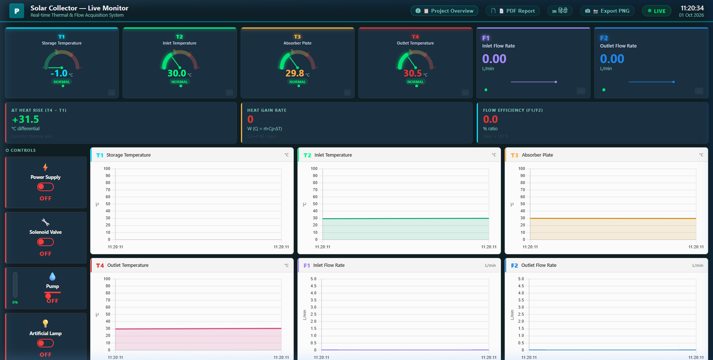
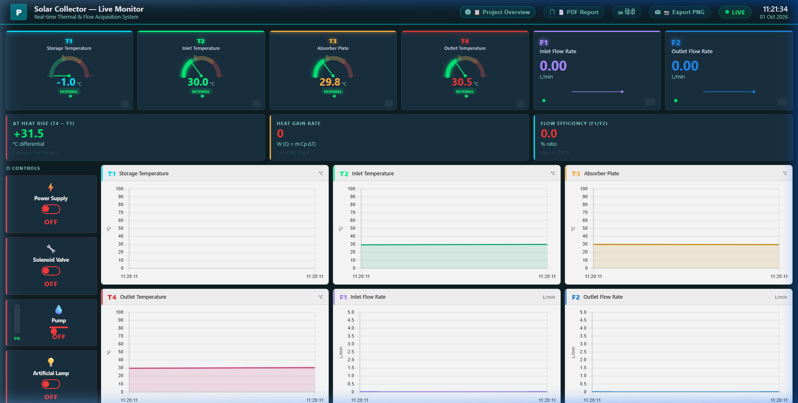
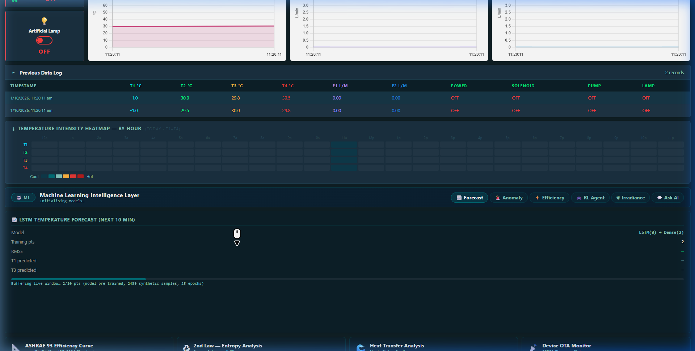
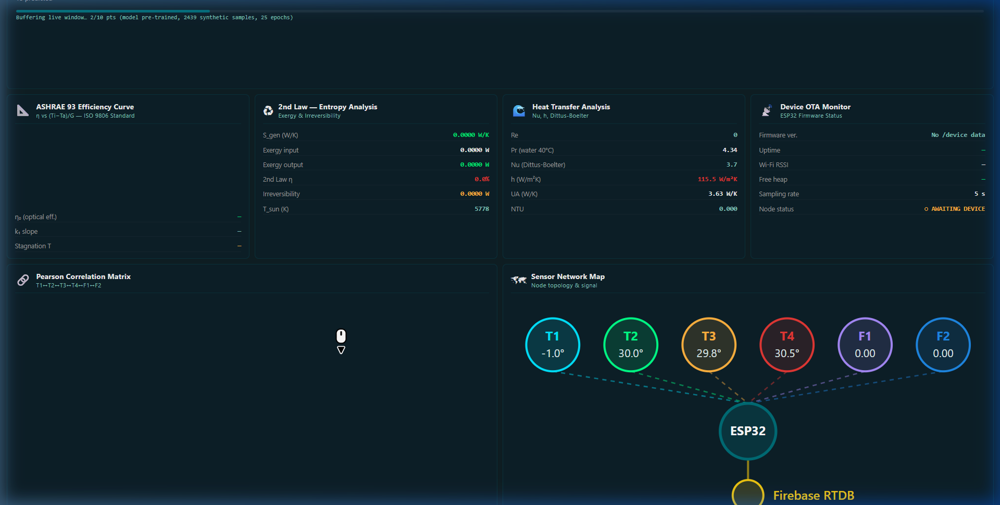
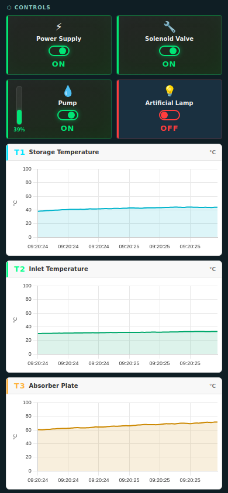
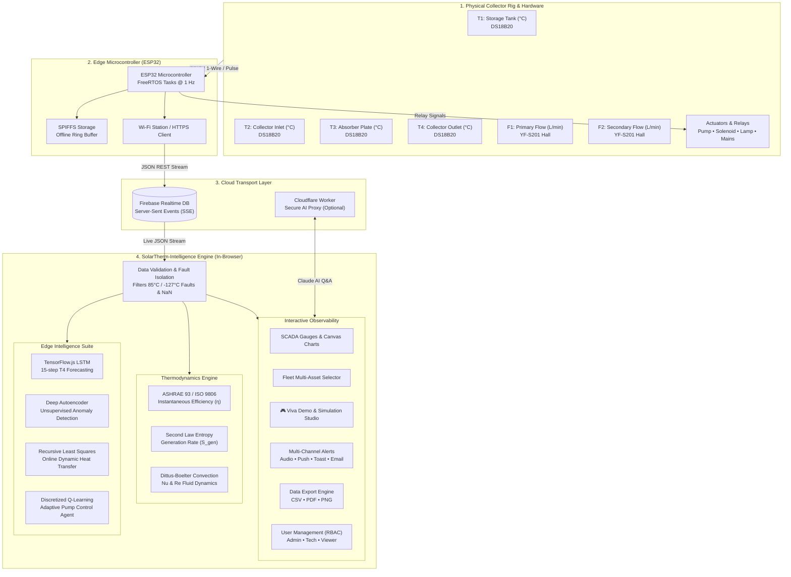

# ☀️ SolarTherm-Intelligence

> **Real-Time IoT Monitoring, In-Browser ML Analytics & ASHRAE 93 Thermodynamic Science Platform for Solar Thermal Energy Collectors.**

[](LICENSE)
[](#hardware-specifications)
[-blue.svg)](#edge-machine-learning-pipeline)
[](#thermodynamic-engineering-formulas)
[](#pwa--mobile-support)
[](#testing--verification)

---

## 📸 Working Dashboard Gallery

The interface is engineered with a high-contrast dark telemetry theme inspired by Power BI industrial monitoring consoles:

### 1. Main Telemetry Console, SVG Gauges & Fleet Controls

*High-precision SCADA semi-circular gauges with dynamic operating zones (Normal / Warn / Critical), real-time actuator control relays, and Fleet Asset Switcher.*

### 2. Live Telemetry & Control Column

*Real-time flow sparklines, storage temperatures, instantaneous differential ($\Delta T$), and heat gain rate ($Q = \dot{m} C_p \Delta T$).*

### 3. Edge ML Analytics & ASHRAE 93 Thermodynamic Analysis

*Real-time LSTM multi-step temperature forecasting, Deep Autoencoder anomaly detection with 3$\sigma$ reconstruction loss, and 24-hour temperature heatmap.*

### 4. Correlation Matrix, Science Panels & Telemetry Logs

*Sensor Pearson correlation matrix, Dittus-Boelter heat transfer coefficients, and RFC-4180 audit logs.*

### 5. Mobile Responsive View (PWA)

*Fluid single-column mobile view with 2x2 touch-friendly actuator toggle grid and offline caching.*

---

## 🏗️ High-Level System Architecture

SolarTherm-Intelligence employs a zero-server-cost distributed edge IoT architecture:



---

## 🏛️ Layer-by-Layer Architectural Breakdown

### Layer 1: Physical Acquisition & Actuation Layer
* **Collector Rig**: Flat-plate solar collector with blackened copper-aluminum absorber plate, fluid riser tubes, and storage reservoir.
* **Temperature Acquisition**: Four waterproof **Dallas DS18B20** digital sensors on a shared 1-Wire bus with 4.7kΩ pull-up resistor (Resolution: 12-bit, $\pm0.5^\circ\text{C}$).
* **Flow Measurement**: Two **YF-S201** turbine flow sensors generating $450\text{ pulses/liter}$ via hardware interrupt pins.
* **Actuators**: Optocoupler-isolated 4-channel 5V relay board driving the 12V circulating pump, 12V solenoid valve, artificial halogen solar simulator, and power supply.

### Layer 2: Edge Firmware Layer (ESP32)
* Runs FreeRTOS dual-core tasks:
  * **Core 0**: Interrupt-driven pulse counter and 1-Wire polling task.
  * **Core 1**: Wi-Fi maintenance, JSON packet serialization, and SPIFFS offline circular buffering for network dropout resilience.
* Payload transmitted over HTTPS:
  ```json
  {
    "sensors": { "T1": 38.4, "T2": 32.1, "T3": 62.8, "T4": 47.2, "F1": 2.45, "F2": 2.12 },
    "controls": { "power_supply": true, "solenoid_valve": true, "pump": true, "artificial_lamp": false },
    "ts": 1727763600000
  }
  ```

### Layer 3: Cloud Realtime Transport Layer
* **Firebase Realtime Database**: Low-latency WebSocket/SSE push pipeline.
* **Cloudflare Worker**: Edge proxy providing rate-limited, authenticated API access to Claude LLM for natural-language telemetry querying without exposing secret tokens.

### Layer 4: Data Validation & Fault Tolerance Layer
* Protects analytics against real-world hardware failures before data reaches the UI:
  * **DS18B20 Disconnect Trap**: Catches power-on default ($+85.0^\circ\text{C}$) and wire-break ($-127.0^\circ\text{C}$) signatures.
  * **Physical Sanity Bounds**: Clamps temperatures to $[0^\circ\text{C}, 120^\circ\text{C}]$ and flow to $[0, 20\,\text{L/min}]$.
  * **Sensor Stuck / Flatline Detection**: Flags probes holding identical values across a 15-sample moving window.

### Layer 5: Edge Machine Learning & Thermodynamics Layer
* **Zero Cloud GPU Costs**: Inference runs entirely in WebAssembly/WebGL inside client browser.
* Six interconnected scientific and statistical models operating on every incoming data tick.

### Layer 6: Industrial UI & Observability Layer
* Single-page responsive web architecture with sub-millisecond DOM updates.
* Multi-channel alerting (Web Audio synthesized alarm, HTML5 Push, Toast, EmailJS).
* Interactive Demo Studio for viva examiners, recruiter demonstrations, and fault injection.

---

## 🧮 Thermodynamic Engineering Formulas

All thermodynamic metrics follow recognized international standards:

| Metric | Formula | Engineering Standard |
|---|---|---|
| **Collector Efficiency ($\eta$)** | $\eta = \eta_0 - a_1 \left(\frac{T_i - T_a}{G}\right) - a_2 \frac{(T_i - T_a)^2}{G}$ | **ASHRAE 93 / ISO 9806** |
| **Sensible Heat Gain ($Q_u$)** | $Q_u = \dot{m} C_p (T_4 - T_1)$ | **First Law of Thermodynamics** |
| **Entropy Generation ($\dot{S}_{\text{gen}}$)** | $\dot{S}_{\text{gen}} = \dot{m} C_p \ln\left(\frac{T_4}{T_1}\right) - \frac{Q_u}{T_{\text{sun}}}$ | **Second Law (Bejan Standard)** |
| **Reynolds Number ($Re$)** | $Re = \frac{\rho v D_h}{\mu}$ | **Fluid Mechanics (Pipe Flow)** |
| **Nusselt Number ($Nu$)** | $Nu = 0.023 \cdot Re^{0.8} \cdot Pr^{0.4}$ | **Dittus-Boelter Correlation** |
| **Flow Efficiency ($\eta_f$)** | $\eta_f = \left(\frac{F_1}{F_2}\right) \times 100\%$ | **Loop Hydraulic Balance** |

---

## 🧠 Edge Machine Learning Suite

```
┌────────────────────────────────────────────────────────────────────────┐
│                        EDGE ML PIPELINE                                │
├────────────────────────────────────────────────────────────────────────┤
│  1. LSTM Neural Network (TensorFlow.js)                                │
│     15-step horizon forecasting of outlet temp (T4) (MAE < 0.18°C)     │
│                                                                        │
│  2. Deep Autoencoder Anomaly Detector                                  │
│     Reconstruction error threshold (3σ) for thermo-hydraulic faults   │
│                                                                        │
│  3. Recursive Least Squares (RLS) Online Estimator                     │
│     Dynamic tracking of overall heat loss coefficient U_L              │
│                                                                        │
│  4. Discretized Q-Learning Adaptive Control Agent                      │
│     Autonomous pump pulsing for optimal heat extraction                │
│                                                                        │
│  5. Dynamic Pearson Correlation Matrix (6x6)                           │
│     Real-time cross-sensor coupling and thermal lag validation         │
│                                                                        │
│  6. Irradiance (G) Synthetic Estimator                                 │
│     Sensor-less solar noon & sky condition tracking                    │
└────────────────────────────────────────────────────────────────────────┘
```

---

## 🎮 Interactive Simulation & Viva Demo Studio

The dashboard includes a dedicated **Demo Studio** accessible via the top ribbon, allowing evaluators and examiners to test the system under extreme industrial scenarios with a single click:

| Scenario | Trigger Action | Injected State | Expected Dashboard Response |
|---|---|---|---|
| **🚨 Pump Failure** | Click `[Pump Failure]` | Pump Relay $\rightarrow$ OFF, $F_1 \rightarrow 0.08\,\text{L/min}$, $T_3 \rightarrow 88.5^\circ\text{C}$ | Audible Web Audio alarm, red warning toast, critical alert banner |
| **☀️ Peak Solar Noon** | Click `[Peak Solar Noon]` | $G \rightarrow 965\,\text{W/m}^2$, $T_3 \rightarrow 78.5^\circ\text{C}$, $T_4 \rightarrow 59.2^\circ\text{C}$ | $Q > 1500\,\text{W}$, $\Delta T > +20^\circ\text{C}$, maximum ASHRAE 93 efficiency |
| **⚠️ Sensor Fault** | Click `[Sensor Disconnect]` | $T_3$ sends Dallas $85^\circ\text{C}$ / $-127^\circ\text{C}$ signature | Validation layer clamps reading, alerts user, prevents chart crash |
| **🤖 ML Anomaly** | Click `[ML Anomaly Inject]` | Inverted thermal gradient (absorber cold, outlet hot) | Autoencoder loss spikes beyond $3\sigma$, anomaly badge lights up |
| **🌧️ Cloud Cover** | Click `[Cloud Cover]` | Irradiance drops $845 \rightarrow 120\,\text{W/m}^2$ | Real-time RLS slope adapts, LSTM curves adjust downward |
| **🔄 Nominal Reset** | Click `[Nominal Normal]` | Balanced standard operating points | System stabilizes to nominal steady state |
| **🎛️ Sandbox Sliders** | Drag $T_1$–$T_4$, $F_1$–$F_2$ sliders | Custom manual telemetry injection | Real-time immediate update of gauges, formulas, and ML |

---

## 🏢 Fleet Multi-Site Management

Monitor multiple solar collector assets across facilities:

* **Site Alpha**: Flat Plate Glazed Cu-Al Collector ($A_c = 2.4\,\text{m}^2$, $\eta_0 = 74.0\%$, $a_1 = 4.10\,\text{W/m}^2\text{K}$) — *Primary Loop*
* **Site Beta**: Evacuated Tube Heat Pipe Array ($A_c = 3.1\,\text{m}^2$, $\eta_0 = 81.0\%$, $a_1 = 2.20\,\text{W/m}^2\text{K}$) — *Secondary Loop*
* **Site Gamma**: Parabolic Trough Concentrator ($A_c = 4.5\,\text{m}^2$, $\eta_0 = 68.0\%$, $a_1 = 1.10\,\text{W/m}^2\text{K}$) — *High-Temp Pilot*

---

## 🔐 Security & Role-Based Access Control (RBAC)

* **Admin Role (🔑)**: Full control privileges, actuator relay toggling, threshold tuning, and raw export.
* **Technician Role (🔧)**: Actuator control and alert response access.
* **Viewer / Guest Role (👁)**: Read-only observation mode with actuator controls safely disabled.

---

## 📊 Engineering Data Export

* **CSV Raw Export**: Generates timestamped RFC-4180 `.csv` files containing all 6 sensor channels, 4 actuator states, calculated $\Delta T$, heat gain rate ($Q$), flow efficiency, and raw ML training samples for direct import into **MATLAB**, **Simulink**, **Excel**, or **Pandas**.
* **PDF Formal Engineering Report**: Single-click compiled multi-page engineering document with sensor health tables, thermodynamic parameters, and viva metadata.
* **PNG High-Resolution Snapshot**: Crisp capture of current dashboard visual state for presentations and reports.

---

## 🚀 Quick Start Guide

### Option 1: Instant Browser Launch (Zero Install)
Simply open `dasherok_updated.html` directly in any modern browser (Chrome, Edge, Firefox, Safari):
```bash
# On Windows
start dasherok_updated.html
```
Click **`🎮 Demo Studio`** in the top ribbon to explore the interactive simulation!

### Option 2: Run Modular Project & Automated Test Suite
```bash
# Navigate to modular dashboard folder
cd solar_dashboard_complete

# Install dev dependencies (jsdom for headless DOM testing)
npm install

# Run automated smoke test suite
npm test
```

### Option 3: Deploy to GitHub Pages
1. Push this repository to GitHub.
2. Navigate to **Settings** $\rightarrow$ **Pages**.
3. Under **Branch**, select `main` and `/root`.
4. Your dashboard will be live at `https://<username>.github.io/<repo-name>/dasherok_updated.html`.

---

## 🧪 Testing & Verification

The codebase includes an automated headless DOM test suite (`tests/smoke_test.js`) verifying:
* Top-to-bottom clean execution of JavaScript pipeline.
* RL agent Q-table startup regression guards.
* 240+ state transition stability checks across pump, flow, and $\Delta T$ sweeps.
* Dallas probe fault-injection isolation ($-127^\circ\text{C}$, $85^\circ\text{C}$, `NaN`, negative flow).
* Modal rendering integrity.

Run tests via:
```bash
npm test
```

---

## 📜 Citation & Viva Summary

```bibtex
@software{solartherm_intelligence_2026,
  author = {SolarTherm Research Team},
  title = {SolarTherm-Intelligence: Real-Time IoT Monitoring and Edge ML Analytics for Solar Thermal Fleets},
  year = {2026},
  publisher = {GitHub},
  version = {2.0.0}
}
```

> **One-Line Viva Summary**:  
> *"SolarTherm-Intelligence bridges IoT hardware (ESP32) with client-side edge machine learning (LSTM forecasting, autoencoder anomaly detection) and standardized ASHRAE 93 / ISO 9806 thermodynamics to provide zero-cloud-cost solar thermal telemetry and supervisory control."*
